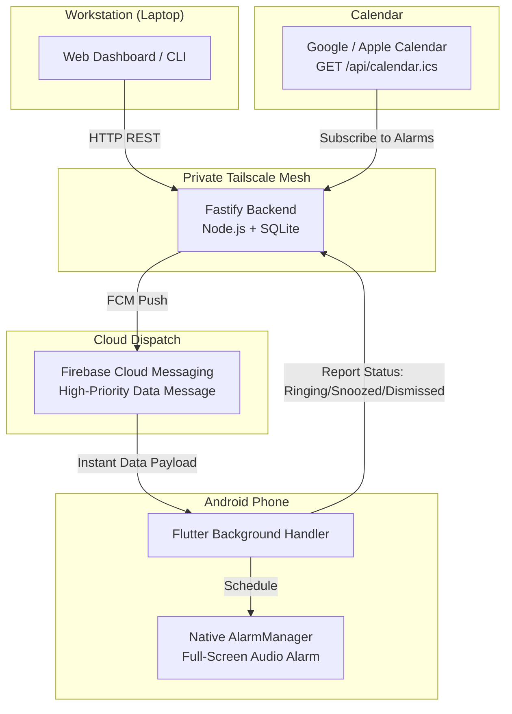

# Remote Alarm

A personal system to remotely create, update, and dismiss loud, full-screen alarms on my Android phone directly from my laptop or terminal.

Built with a Fastify (Node.js + TypeScript + SQLite) backend, a Flutter Android client using native `AlarmManager`, and Firebase Cloud Messaging (FCM) high-priority data payloads over a private Tailscale network.

---

## Why I Built This

I forget things easily.

Standard reminders (Google Calendar, Apple Reminders, Todoist, etc.) just don't work for me:
- **They are too polite.** A quiet little banner in the notification shade is too easy to ignore or swipe away without doing the task.
- **DND & battery savers silence them.** Android loves to suppress or delay background notifications when the screen is off or Do Not Disturb is on.
- **Friction when working.** When I'm locked in at my laptop, stopping to grab my phone, unlock it, and fiddle with the clock app breaks my flow.

I needed **actual alarms** — full-screen, continuous ringtone, overriding silent mode — that I can set, edit, or dismiss straight from my computer (via a web dashboard or a quick `curl` command) without touching my phone.

### Why not existing apps?
- **Galarm:** Decent concept, but closed ecosystem, subscription paywalls, and no easy way to hook into my own scripts or terminal.
- **TickTick:** Great task manager, but its alarms are just standard notification banners, not persistent hardware-level alarms.
- **notify.sh / Pushover:** One-way notification pushes. They can't schedule native Android `AlarmManager` events or cancel/modify an alarm that's already set.

---

## How It Works



### Key Features for My Workflow
- **Loud & Intrusive:** Uses Android's `AlarmManager` and full-screen intents. It rings like a morning alarm, bypassing DND and silent mode.
- **Remote Control:** Set, snooze, or cancel alarms from my browser (`http://localhost:3000`) or automated shell scripts.
- **Day-of-Week Recurrence:** Select `M T W T F S S` for repeating alarms.
- **Persistent Snooze Tracking:** Shows an amber `⚡ SNOOZED` badge on both phone and dashboard so I know what's been snoozed.
- **Calendar Subscription:** Exposes an RFC 5545 feed at `GET /api/calendar.ics` so all my alarms show up on my Google/Apple Calendar.
- **Zero Open Ports:** Everything communicates over my private Tailscale mesh network.

---

## Quick Start

### 1. Backend

```bash
cd backend
npm install
cp .env.example .env
# Place your Firebase service-account.json in backend/
npm run dev
```
Dashboard runs at `http://localhost:3000`.

### 2. Mobile (Android)

```bash
cd mobile
# Place your google-services.json in mobile/android/app/
flutter pub get
flutter run -d <your-device-id>
```
On first launch, grant notification and exact alarm permissions. The device registers its FCM token with the backend automatically.

---

## API Summary

| Method | Endpoint | Description |
| :--- | :--- | :--- |
| `GET` | `/api/alarms?view=active\|history` | List active or past dismissed alarms |
| `POST` | `/api/alarms` | Schedule new alarm (`{ target_time, label, repeat_days, sound_tone, ramp_seconds }`) |
| `DELETE` | `/api/alarms/:id` | Cancel alarm and remove from phone via FCM `CANCEL` |
| `POST` | `/api/alarms/:id/silence` | Remotely silence active ringing phone ringer via FCM `DISMISS` |
| `POST` | `/api/alarms/:id/state` | Update state (`ringing`, `snoozed`, `dismissed`) |
| `GET` | `/api/calendar.ics` | Live RFC 5545 iCal feed for Google/Apple Calendar |
| `POST` | `/api/devices/register` | Register phone's FCM token with battery/charging telemetry |
| `GET` | `/api/devices` | Query connected devices, battery percentage, and charging state |

---

## Tests & Verification

### 1. Automated Test Suites (CI / Local Offline)
Run the full in-memory backend suite and mobile Flutter test harness:
```bash
./run_tests.sh
```
- **Backend (`backend/test/`):** 24 tests across 11 suites verifying REST APIs, iCalendar feeds, state transitions, FCM dispatch payloads, disabled/pending slider states, and isolated in-memory persistence.
- **Mobile (`mobile/test/`):** 22 tests verifying recurrence calculations, payload sanitization, audio tone mappings, rich text notes storage, reconnection catch-up reconciliation, and offline safety.

### 2. Live Physical Device E2E Verification (via ADB)
When an Android device is plugged in via USB:
```bash
# Run standalone on-device sync test
./scripts/test_live_device_sync.sh

# Or run full suite including device test
./run_tests.sh --with-device
```
This automated runner verifies live FCM push delivery, remote toggle synchronization, network disconnection resilience, and automatic catch-up reconciliation directly on hardware.

---

## Acknowledgements & Core Libraries

- **[`alarm`](https://pub.dev/packages/alarm)** (Flutter plugin by [Gregory Foret](https://github.com/gdelataillade)): The core hardware-level alarm engine for this project. It reliably manages Android exact alarms via native `AlarmManager`, Android foreground services, CPU wake locks, audio focus management, and full-screen intent launches that override Do Not Disturb (DND) and silent mode.
- **[Firebase Cloud Messaging (FCM)](https://firebase.google.com/docs/cloud-messaging)**: Powers the instant, high-priority background data synchronization between workstation and phone with zero open inbound ports.
- **[Fastify](https://fastify.dev/) & [better-sqlite3](https://github.com/WiseLibs/better-sqlite3)**: Powers the fast, local-first backend with WAL mode concurrency and iCalendar RFC 5545 feed generation.

---

## Features & Roadmap

See [docs/ROADMAP.md](file:///Users/dsam/Documents/remotealarm/docs/ROADMAP.md) for full architecture details and future expansions (calendar auto-ingest, mission dismissal challenges, morning TTS briefings).
