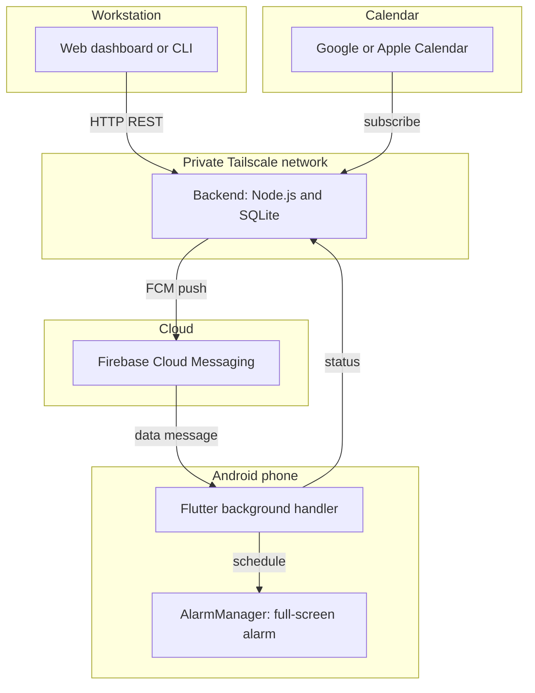

# Remote Alarm

A personal system that makes loud alarms ring on an Android phone. You control the alarms from a computer. You can create, change, and stop an alarm from that computer.

The system has three parts:

- A backend. It uses Fastify, Node.js, TypeScript, and SQLite.
- An Android client. It uses Flutter and the native `AlarmManager`.
- Firebase Cloud Messaging (FCM). It sends high-priority data messages.

All traffic goes through a private Tailscale network.

---

## Why I built this

I forget things easily.

Standard reminders do not work for me. Examples are Google Calendar, Apple Reminders, and Todoist. They have three problems:

- The notification is quiet. You can ignore it. You can clear it, and the task stays undone.
- Android can hold back the notification. When the screen is off, or when Do Not Disturb is on, the notification can arrive late or not at all.
- The reminder stops your work. You must find the phone, unlock it, and open the clock app.

I need real alarms. A real alarm uses the full screen. It plays a continuous ringtone. It overrides silent mode. I can set it, change it, or stop it from my computer.

### Why I did not use other apps

- Galarm: The idea is good. The system is closed, and it needs a paid subscription. You cannot connect your own scripts.
- TickTick: It is a good task manager. Its alarms are only notification banners. They are not hardware alarms.
- notify.sh and Pushover: These tools send notifications in one direction only. They cannot schedule an Android `AlarmManager` event. They cannot cancel or change an alarm that is already set.

---

## How it works



### Features

- Loud alarms. The system uses the Android `AlarmManager` and a full-screen intent. The alarm overrides Do Not Disturb and silent mode.
- Remote control. You can set, snooze, or cancel an alarm from a browser at `http://localhost:3000`, or from a shell script with `curl`.
- Recurrence. You can select the days of the week with the labels `M T W T F S S` for an alarm that repeats.
- Snooze status. The phone and the dashboard show a SNOOZED badge for a snoozed alarm.
- Calendar subscription. The backend supplies an RFC 5545 feed at `GET /api/calendar.ics`.
- No open ports. All traffic goes through a private Tailscale network.

---

## Setup

### 1. Homelab deployment (Docker Compose and Tailscale)

Do these steps on the homelab server. The server can run Linux, Proxmox, TrueNAS, or Unraid.

1. Clone the repository.

   ```bash
   git clone https://github.com/danieltsam/remotealarm.git
   cd remotealarm
   ```

2. Copy the Firebase service account file into `backend/`.

   ```bash
   cp /path/to/service-account.json backend/service-account.json
   ```

3. Start the containers.

   ```bash
   docker compose up -d
   ```

The server listens on `0.0.0.0:3000`. To open the dashboard, use the Tailscale name of the server, or its Tailscale address. For example, `http://<homelab-tailscale-name>:3000` or `http://<100.x.y.z>:3000`.

### 2. Local development (Node.js)

To run the backend on the same computer, do these steps:

```bash
cd backend
npm install
# Copy service-account.json into backend/
npm run dev
```

### 3. Mobile client (Android)

1. Open the Remote Alarm app.
2. Open Settings. Tap the slider icon in the top bar.
3. Find Backend Server URL. Enter the Tailscale address of the homelab. For example, `http://homelab:3000` or `http://100.x.y.z:3000`.
4. Tap Save.
5. The app does three steps. It tests the connection. It sends its FCM token and the battery data to the backend. It synchronizes the alarms.

---

## API

| Method | Endpoint | Function |
| :--- | :--- | :--- |
| `GET` | `/api/alarms?view=active\|all` | List the active alarms, or all alarms |
| `POST` | `/api/alarms` | Schedule a new alarm. The body contains these fields: `{ target_time, label, repeat_days, sound_tone, ramp_seconds, description }` |
| `DELETE` | `/api/alarms/:id` | Cancel an alarm. The backend removes it from the phone with the FCM `CANCEL` message |
| `POST` | `/api/alarms/:id/silence` | Stop an alarm that is ringing. The backend sends the FCM `DISMISS` message |
| `POST` | `/api/alarms/:id/state` | Change the state to `pending`, `disabled`, `ringing`, `snoozed`, or `dismissed` |
| `GET` | `/api/settings` | Get the user preferences. These are the sound tone, the ramp seconds, the time format, and the date format |
| `POST` | `/api/settings` | Change the user preferences |
| `GET` | `/api/calendar.ics` | Get the RFC 5545 iCal feed for Google Calendar or Apple Calendar |
| `GET` | `/api/calendar/status` | Get the configuration and the sync status of the Google Calendar mirror |
| `POST` | `/api/alarms/report-missed` | A device reports the alarms that it did not arm because their time passed |
| `POST` | `/api/devices/register` | Register the FCM token of the phone, with the battery and charging data |
| `GET` | `/api/devices` | Get the connected devices, the battery level, and the charging state |

---

## Google Calendar sync

When you enable this function, the backend copies each alarm into a Google Calendar with the name "Remote Alarms". The backend makes this calendar if it does not exist. The read-only `GET /api/calendar.ics` feed stays available.

The mirror gives you event reminders in Google Calendar. The phone receives the hardware alarm through FCM.

> Remote Alarm is the only source of the data. The backend sends the events, and it repairs differences every 15 minutes. If you change or delete an event directly in Google Calendar, the next repair step overwrites or removes it. Always make your changes in Remote Alarm.

`GET /api/calendar/status` shows if the mirror is configured and healthy. It also shows the calendar id, the time of the last sync, and the time of the last error. It never returns the credentials.

If Google rejects the stored credential, or if the credential expires, the mirror does not fail in silence. The system does two things:

- It writes a `[gcal] AUTH FAILED` message to the log. The message comes from the push path and from the 15-minute repair path. Thus the message also appears when you do not make new alarms. That is the time when a dead credential is difficult to find.
- The `GET /api/calendar/status` endpoint reports `needs_reauth: true` and `last_error_kind: "auth"`.

To correct this condition, run `npm run gcal:auth` again. Then copy the new token file. The alarms work during this condition. Only the calendar mirror stops.

### Setup (one time, manual)

1. Make a Google Cloud project. Enable the Google Calendar API.
2. Configure the OAuth consent screen. Set the user type to External. Set the publishing status to In production.
   - In Testing status, Google issues a refresh token that expires after 7 days. The sync stops until you agree to the conditions again. The In production status removes this limit.
   - You do not need verification for personal use with less than 100 users.
   - The Google Cloud console blocks the In production status until you complete the Branding page. The page needs the app name, the support email address, a homepage URL, a privacy policy URL, and an authorized domain. The Terms of Service URL and the logo are necessary only for verification, not for publishing.
   - If you have no public page on a domain that you own, you can stay in Testing status. Run `npm run gcal:auth` again when the credential expires. The log and the status endpoint tell you when this is necessary.
   - Two cautions. First, the In production status does not revoke a credential that already exists. Second, Google applies the 7-day limit when it issues a token. Thus an old credential can live longer than the limit that applies to a new credential.
3. Examine the scope in the Data Access page. The scope must be `.../auth/calendar.app.created`. The app can see only the calendars that it made.
4. Make an OAuth client of the type Desktop app. Record the client ID and the client secret.
5. Put the credentials in `backend/.env`. See `backend/.env.example`. Then run `npm run gcal:auth`, and copy the token file `google-oauth-token.json` to the data directory on the homelab. The file has the mode 600.

The mirror is off until you set `GCAL_ENABLED=true`. A server without this setting is correct and does nothing.

The variable `GCAL_TIMEZONE` must contain the IANA zone of the phone, for example `Australia/Brisbane`. Do not use the zone of the server. This variable controls the expansion of a recurrence. The container does not need a `TZ` setting for correct operation, but a `TZ` setting gives better timestamps in the log.

### Docker deployment

To use the mirror in the container, do these steps on the homelab server:

1. Make a file with the name `.env` in the repository root. Git ignores this file. Put these four lines in it:

   - `GCAL_ENABLED=true`
   - `GOOGLE_OAUTH_CLIENT_ID=<your client ID>`
   - `GOOGLE_OAUTH_CLIENT_SECRET=<your client secret>`
   - `GCAL_TIMEZONE=<your IANA zone>`

2. Copy the token file to `data/google-oauth-token.json`. The container reads the data directory. The file must have the mode 600.
3. Start the container again.

   ```bash
   docker compose up -d --build
   ```

The container sets `GOOGLE_OAUTH_TOKEN_PATH` to `/app/data/google-oauth-token.json`. That variable is a path, not a secret. The client secret stays in the `.env` file and does not go into git.

A database with no calendar id makes a new "Remote Alarms" calendar at the first alarm. To use a calendar that already exists, put its id in the `settings` table under the key `gcal_calendar_id` before you start the container.

---

## Missed alarms

An alarm can fail to ring. The usual cause is a phone that cannot receive the FCM message. But any cause has the same result. The alarm does not ring.

Remote Alarm records the failure. It does not move the alarm to a later time.

### The grace window

A one-time alarm rings if it is late by less than 5 minutes. The phone arms an alarm in this condition.

If the alarm is late by more than 5 minutes, it is **missed**. A missed alarm never rings. The system does not move a missed alarm to a later time.

A recurring alarm is different. A daily alarm, a weekday alarm, or a fortnightly alarm always moves to its next occurrence. The system never marks a recurring alarm as missed.

### The record

A missed alarm has the status `missed`. The record also has these fields:

- `missed_at`: the time when the system found the failure.
- `missed_reason`: the reason that the system could determine.

The reason is one of these values:

- `no_device_registered`: no device was registered, so the system sent nothing.
- `delivery_failed`: the system could not send the message.
- `dispatched_not_reported`: the system sent the message, and the phone did not report the alarm. This value does not mean that the phone received the message.
- `device_reported_stale`: the phone found the alarm after its time, and did not arm it.
- `device_reported_failed`: the phone tried to fire the alarm, and could not.
- `unknown`: the system has no record of a dispatch.

### Where you can see it

- The mobile app shows missed alarms in a Missed group. The action on a missed alarm is **Reschedule**. You select a new date and a new time. The alarm does not move without your action.
- The web dashboard shows the same record.
- The Google Calendar mirror keeps the event. It adds the failure, the time, and the reason to the description.

The endpoint `GET /api/alarms?view=all` returns missed alarms. The `active` view does not.

The backend finds a missed alarm in two ways. It examines the alarms every 60 seconds. It also accepts a report from the phone, when the phone refuses to arm a stale alarm.

---

## Tests

### 1. Automatic test suites

Run this command to start the backend suite, the mobile Flutter suite, and the clients suite. The backend suite uses a memory database.

```bash
./run_tests.sh
```

- Backend: The directory `backend/test/` contains 144 tests in 40 suites. The tests examine these items:

  - The REST API.
  - The iCalendar feed.
  - The state changes.
  - The FCM payloads.
  - The slider states.
  - The memory database.
  - The Google Calendar event mapping, the credential states, the idempotent writes, and the reconciliation.
  - The missed-alarm sweep, the reason values, and the report endpoint.
  - The guards that stop the suite from reaching the live Google API or a real database.

- Mobile: The directory `mobile/test/` contains 81 tests. The tests examine these items:

  - The recurrence calculations.
  - The payload data.
  - The audio tones.
  - The notes.
  - The reconnection.
  - The offline operation.
  - The refusal to arm a stale one-time alarm, and the report to the backend.

- Clients: The directory `clients/core/test/` contains 137 tests. The tests examine these items:

  - The API client and the time parser.
  - The status labels, including `missed`.
  - The `missed_at` and `missed_reason` fields, and the rule that their copy never claims delivery.

### 2. Live test on a physical device (ADB)

Connect the Android device with a USB cable. Then run one of these commands:

```bash
# Only the sync test on the device
./scripts/test_live_device_sync.sh

# The full suite, with the device test
./run_tests.sh --with-device
```

### 3. Chaos test

The chaos suite examines the operation after these events:

- A process stop.
- A Doze deep sleep.
- A connection failure.
- A bad payload.

```bash
./run_tests.sh --with-chaos
```

---

## Libraries

- [`alarm`](https://pub.dev/packages/alarm) is a Flutter plugin from [Gregory Foret](https://github.com/gdelataillade). It is the alarm engine of this project. It controls these parts of Android:

  - The exact alarms, through the native `AlarmManager`.
  - The foreground services.
  - The CPU wake locks.
  - The audio focus.
  - The full-screen intents.

  The full-screen intents override Do Not Disturb and silent mode.
- [Firebase Cloud Messaging (FCM)](https://firebase.google.com/docs/cloud-messaging) sends the high-priority data between the workstation and the phone. It needs no open inbound port.
- [Fastify](https://fastify.dev/) and [better-sqlite3](https://github.com/WiseLibs/better-sqlite3) are the backend. They give WAL concurrency and the RFC 5545 feed.

---

## Roadmap

See [docs/ROADMAP.md](docs/ROADMAP.md) for the architecture and for the future work. The future work includes automatic calendar input, dismissal tasks, and a spoken morning report.
