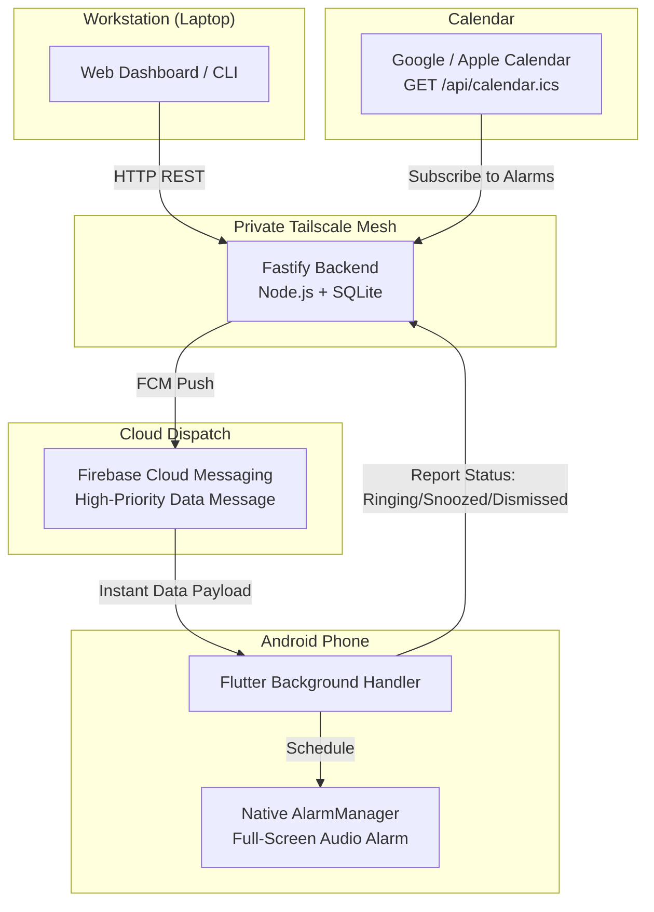

# Remote Alarm

A personal system to remotely create, update, and dismiss loud, full-screen alarms on my Android phone directly from my laptop or terminal.

Built with a Fastify (Node.js + TypeScript + SQLite) backend, a Flutter Android client using native `AlarmManager`, and Firebase Cloud Messaging (FCM) high-priority data payloads over a private Tailscale network.

---

## Why I Built This

I forget things easily.

Standard reminders (Google Calendar, Apple Reminders, Todoist, etc.) just don't work for me:
- **They are too polite.** A quiet little banner in the notification shade is too easy to ignore or swipe away without doing the task.
- **DND & battery savers silence them.** Android loves to suppress or delay background notifications when the screen is off or Do Not Disturb is on.
- **Friction when working.** When I'm locked in at my laptop, stopping to grab my phone, unlock it, and fiddle with the clock app breaks my flow.

I needed **actual alarms** — full-screen, continuous ringtone, overriding silent mode — that I can set, edit, or dismiss straight from my computer (via a web dashboard or a quick `curl` command) without touching my phone.

### Why not existing apps?
- **Galarm:** Decent concept, but closed ecosystem, subscription paywalls, and no easy way to hook into my own scripts or terminal.
- **TickTick:** Great task manager, but its alarms are just standard notification banners, not persistent hardware-level alarms.
- **notify.sh / Pushover:** One-way notification pushes. They can't schedule native Android `AlarmManager` events or cancel/modify an alarm that's already set.

---

## How It Works



### Key Features for My Workflow
- **Loud & Intrusive:** Uses Android's `AlarmManager` and full-screen intents. It rings like a morning alarm, bypassing DND and silent mode.
- **Remote Control:** Set, snooze, or cancel alarms from my browser (`http://localhost:3000`) or automated shell scripts.
- **Day-of-Week Recurrence:** Select `M T W T F S S` for repeating alarms.
- **Persistent Snooze Tracking:** Shows an amber `⚡ SNOOZED` badge on both phone and dashboard so I know what's been snoozed.
- **Calendar Subscription:** Exposes an RFC 5545 feed at `GET /api/calendar.ics` so all my alarms show up on my Google/Apple Calendar.
- **Zero Open Ports:** Everything communicates over my private Tailscale mesh network.

---

## Quick Start & Homelab Deployment

### 1. Homelab Deployment (Docker Compose / Tailscale)

Deploying to a personal homelab server (Linux / Proxmox / TrueNAS / Unraid) on a private Tailscale network:

```bash
# 1. Clone repository on homelab server
git clone https://github.com/danieltsam/remotealarm.git
cd remotealarm

# 2. Place Firebase service-account.json in backend/
cp /path/to/service-account.json backend/service-account.json

# 3. Start via Docker Compose
docker compose up -d
```

The server binds to `0.0.0.0:3000`. On your Tailscale network, access the dashboard at `http://<homelab-tailscale-name>:3000` or `http://<100.x.y.z>:3000`.

### 2. Local Development (Node.js)

```bash
cd backend
npm install
# Place service-account.json in backend/
npm run dev
```

### 3. Mobile Client (Android)

1. Open the Remote Alarm app on Android.
2. Open **Settings** (slider icon in top bar).
3. Under **Backend Server URL**, enter your homelab Tailscale address (e.g. `http://homelab:3000` or `http://100.x.y.z:3000`).
4. Tap **Save**. The app will immediately test connectivity, register its FCM token with battery telemetry, and synchronize alarms.

---

## API Summary

| Method | Endpoint | Description |
| :--- | :--- | :--- |
| `GET` | `/api/alarms?view=active\|all` | List active or all alarms |
| `POST` | `/api/alarms` | Schedule new alarm (`{ target_time, label, repeat_days, sound_tone, ramp_seconds, description }`) |
| `DELETE` | `/api/alarms/:id` | Cancel alarm and remove from phone via FCM `CANCEL` |
| `POST` | `/api/alarms/:id/silence` | Remotely silence active ringing phone ringer via FCM `DISMISS` |
| `POST` | `/api/alarms/:id/state` | Update state (`pending`, `disabled`, `ringing`, `snoozed`, `dismissed`) |
| `GET` | `/api/settings` | Retrieve user preferences (sound tone, ramp seconds, 12h/24h, date formats) |
| `POST` | `/api/settings` | Update user preferences bidirectionally |
| `GET` | `/api/calendar.ics` | Live RFC 5545 iCal feed for Google/Apple Calendar |
| `GET` | `/api/calendar/status` | Google Calendar mirror configuration and sync health |
| `POST` | `/api/devices/register` | Register phone's FCM token with battery/charging telemetry |
| `GET` | `/api/devices` | Query connected devices, battery percentage, and charging state |

---

## Google Calendar Sync

When enabled, every alarm is mirrored into a dedicated **"Remote Alarms"** Google Calendar
(created automatically if missing), alongside the read-only `GET /api/calendar.ics` subscription
feed. This gives event-style reminders with real Google notifications, while the phone still
receives the actual hardware alarm over FCM.

> **Remote Alarm is the single source of truth.** Events are pushed from this backend and drift is
> repaired every 15 minutes. Any edit made directly in Google Calendar (moving, renaming, or
> deleting an event, or adding a new one) is **overwritten or removed** on the next reconcile.
> Always make changes through Remote Alarm.

`GET /api/calendar/status` reports whether the mirror is configured and healthy, the mirror
calendar id, and the last sync/error timestamps. It never returns credentials.

**If the stored credential is rejected or expires**, the mirror does not fail silently:

- it logs a loud `[gcal] AUTH FAILED` line, emitted from both the push path and the 15-minute
  reconcile path — so it appears even when no alarms are being created, which is precisely when a
  dead credential would otherwise go unnoticed;
- `GET /api/calendar/status` reports `needs_reauth: true` with `last_error_kind: "auth"`.

Recovery is to re-run `npm run gcal:auth` and copy the new token file. **Alarms keep working
throughout** — only the calendar mirror pauses.

### Setup (one-time, manual)

1. Create a GCP project and enable the **Google Calendar API**.
2. Configure the OAuth consent screen: user type **External**, and set **publishing status =
   In production**. In **Testing** status Google issues a refresh token that expires after 7 days,
   so sync stops until you re-consent; publishing removes that limit. Verification is *not* required
   for personal use under 100 users, but the console gates publishing behind the **Branding** page:
   app name, support email, a **homepage URL**, a **privacy policy URL**, and an **authorized
   domain**. (Terms of Service and a logo are only needed for *verification*, not publishing.)
   If you have no public page on a domain you own, staying in Testing is workable: re-run
   `npm run gcal:auth` when the credential expires, and the logs and status endpoint will tell you
   when that is. Two caveats: publishing does not revoke an existing grant, and the 7-day limit is
   applied when a token is *issued*, so an older credential can outlive the rule that governs a
   newly issued one.
3. Confirm the scope classification under **Data Access** uses
   `.../auth/calendar.app.created` (the app only sees calendars it created).
4. Create an OAuth client of type **Desktop app**; record the client ID and secret.
5. Add the credentials to `backend/.env` (see `backend/.env.example`), then run
   `npm run gcal:auth` and copy the written token file (`google-oauth-token.json`, mode `600`) to
   the homelab data directory.

The mirror is disabled unless `GCAL_ENABLED=true`; an unconfigured server is a supported no-op.
`GCAL_TIMEZONE` must be the **phone's** IANA zone (e.g. `Australia/Brisbane`), not the server's —
it drives recurrence expansion. The container does not need a `TZ` setting for correctness, though
setting one improves log timestamps.

---

## Tests & Verification

### 1. Automated Test Suites (CI / Local Offline)
Run the full in-memory backend suite and mobile Flutter test harness:
```bash
./run_tests.sh
```
- **Backend (`backend/test/`):** 37 tests across 13 suites verifying REST APIs, iCalendar feeds, state transitions, FCM dispatch payloads, disabled/pending slider states, and isolated in-memory persistence.
- **Mobile (`mobile/test/`):** 46 tests verifying recurrence calculations, payload sanitization, audio tone mappings, rich text notes storage, reconnection catch-up reconciliation, and offline safety.

### 2. Live Physical Device E2E Verification (via ADB)
When an Android device is connected via USB:
```bash
# Run standalone on-device sync test
./scripts/test_live_device_sync.sh

# Or run full suite including device test
./run_tests.sh --with-device
```

### 3. Chaos Engineering & Fault Injection
Run the automated hardware chaos suite to test resilience against process death, Doze deep sleep, server connection failures, and poison pill payloads:
```bash
# Run chaos suite
./run_tests.sh --with-chaos
```

---

## Acknowledgements & Core Libraries

- **[`alarm`](https://pub.dev/packages/alarm)** (Flutter plugin by [Gregory Foret](https://github.com/gdelataillade)): The core hardware-level alarm engine for this project. It reliably manages Android exact alarms via native `AlarmManager`, Android foreground services, CPU wake locks, audio focus management, and full-screen intent launches that override Do Not Disturb (DND) and silent mode.
- **[Firebase Cloud Messaging (FCM)](https://firebase.google.com/docs/cloud-messaging)**: Powers the instant, high-priority background data synchronization between workstation and phone with zero open inbound ports.
- **[Fastify](https://fastify.dev/) & [better-sqlite3](https://github.com/WiseLibs/better-sqlite3)**: Powers the fast, local-first backend with WAL mode concurrency and iCalendar RFC 5545 feed generation.

---

## Features & Roadmap

See [docs/ROADMAP.md](file:///Users/dsam/Documents/remotealarm/docs/ROADMAP.md) for full architecture details and future expansions (calendar auto-ingest, mission dismissal challenges, morning TTS briefings).
