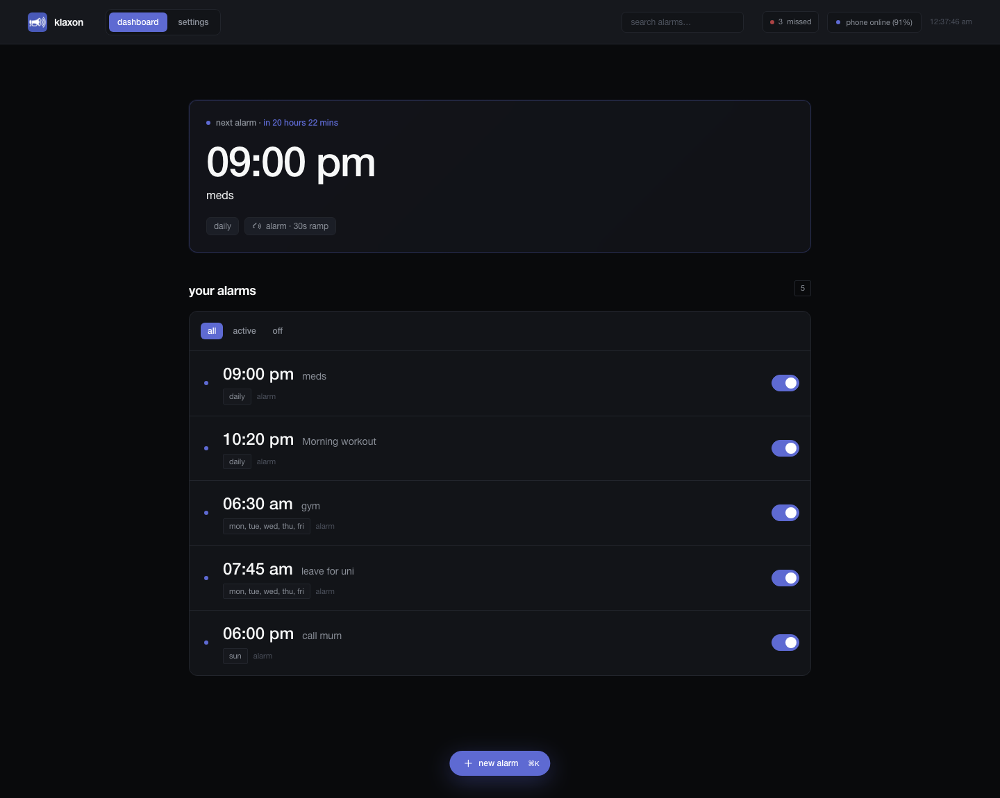
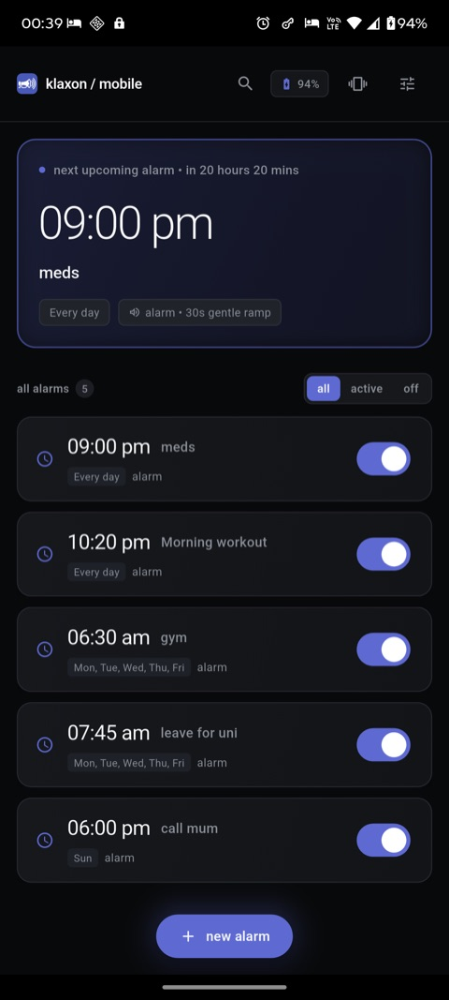
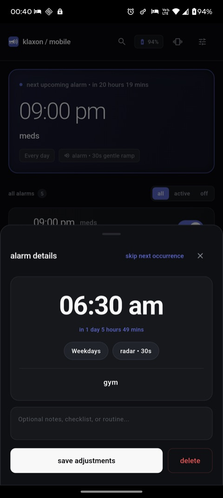
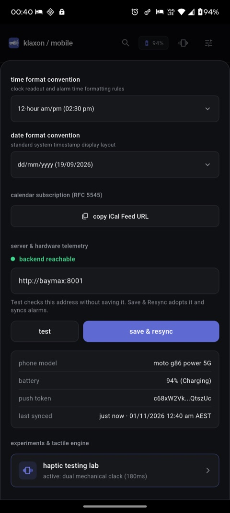
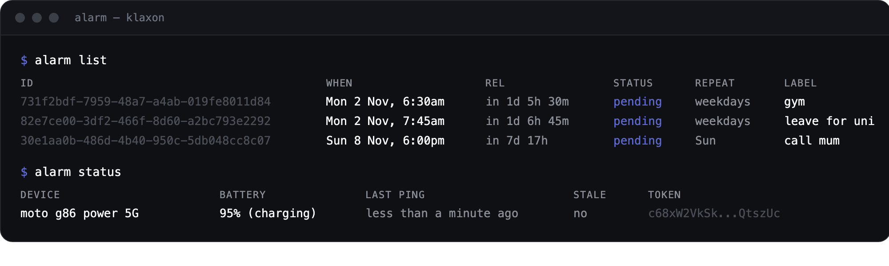
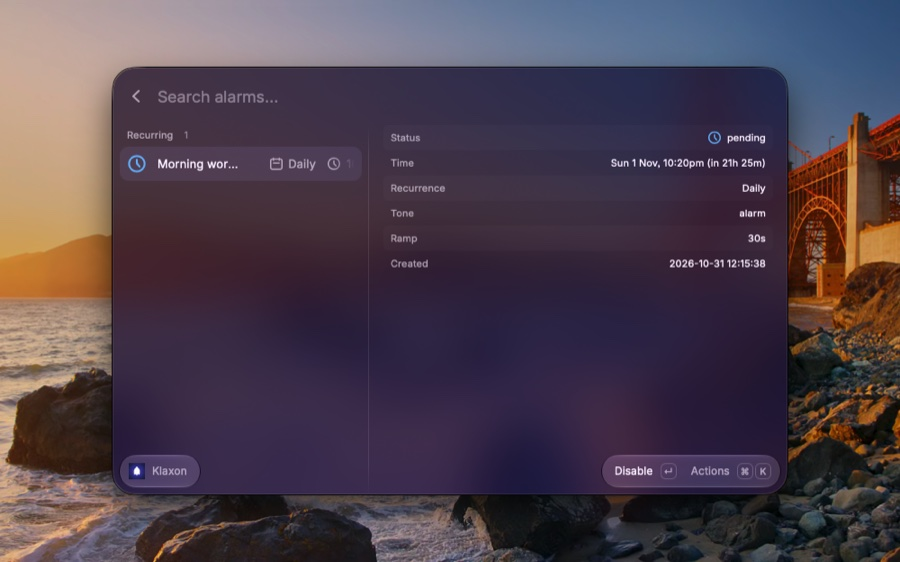
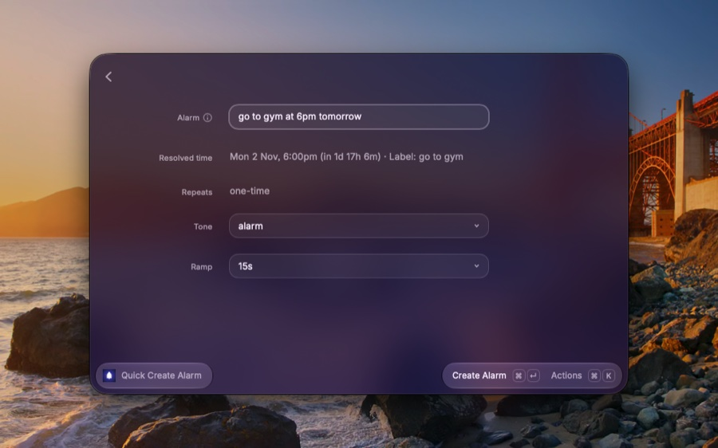

# Klaxon

A self-hosted alarm clock for Android that you run from your computer.

Real alarms, not notifications. They take over the screen, override silent mode and ring until you stop them. Set and manage them from a web dashboard, an HTTP API, a CLI or Raycast. I built it because reminder apps blend into the notification shade and I kept missing things.



<p align="center">
  
  
  
</p>

## What it does

- Sets real Android alarms. Full screen, silent mode overridden, ringing until dismissed.
- Schedules that repeat daily, on weekdays, weekends, chosen days, or every second week.
- Skips one occurrence without switching the schedule off.
- Records missed alarms instead of losing them, and reports whether delivery is working.
- Runs from the dashboard, the `alarm` CLI, Raycast or plain HTTP.

## Quick start

You need Docker, an Android phone with Google Play services, and a Firebase project. Flutter only matters if you want to build the app yourself.

**1. Firebase**

- Create a project at [console.firebase.google.com](https://console.firebase.google.com).
- Add an Android app with the package name `com.klaxon.mobile`.
- Download `google-services.json` and save it as `mobile/android/app/google-services.json`. That path is gitignored, so a fresh clone does not carry one and the Android build needs yours.
- Project settings, service accounts, generate new private key. Save it as `data/service-account.json`.

The second file is what lets the backend push alarms to your phone. The first one is what your phone's build needs to receive them.

**2. Backend**

```bash
cp backend/.env.example .env
docker compose up -d --build
```

Open `http://localhost:8001`. Health is at `/api/health`.

**3. Phone**

Install the APK from [releases](https://github.com/danieltsam/klaxon/releases/latest), or build it:

```bash
cd mobile
flutter build apk --debug
adb install -r build/app/outputs/flutter-apk/app-debug.apk
```

**4. Point the phone at the backend**

In the app, open settings, find server and hardware telemetry, paste your backend address (`http://<your-computer>:8001`) and tap save and resync. Testing over USB? Run `adb reverse tcp:8001 tcp:8001` and use `http://127.0.0.1:8001`.

**5. Check it works**

Create an alarm on the dashboard. It appears in the phone's list within a second or two. Set one for a minute from now to hear it.

If the phone is on another network, put both on Tailscale and use the tailnet address. There is no login, so keep the port off the public internet.

## Skipping one morning

Late night, and 6:30am is not happening. Open the alarm on the phone or the dashboard and use skip next occurrence. The next one is consumed, the alarm stays on, and it rings again the morning after. Undo puts it back until that time passes.

The same thing from a terminal:

```bash
alarm skip <id>
alarm unskip <id>
```

## The clients

- Dashboard: create, edit, filter, silence a ringing alarm, copy the iCal feed. Missed alarms sit behind a count in the header, so they never shove the page around.
- Phone: alarm list with all, active and off filters, a detail sheet with skip and undo, and live device telemetry.
- CLI: `alarm "tomorrow 7am" gym`, `alarm list`, `alarm status`, `alarm skip <id>`.
- Raycast: list and create alarms without leaving the keyboard.



<p align="center">
  
  
</p>

## When something goes wrong

`GET /api/health` returns a `delivery_health` object with `ok` and `reasons`. The reasons are `no_registered_devices`, `firebase_uninitialized`, `dispatch_failed` and `alarm_missed`. The dashboard shows a banner when delivery is unverified.

A dispatch is not proof of delivery, so the system reports dispatched, never delivered. If a phone never reports back after an alarm was sent, the alarm is recorded as missed with the reason, rather than quietly disappearing.

Want a message somewhere else? Set `ALERT_WEBHOOK_URL` and `ALERT_WEBHOOK_KIND` to `generic`, `discord`, `slack` or `healthchecks`. Messages are throttled to one per problem per 30 minutes. `healthchecks` is a dead man's switch: the backend pings on every sweep, and the alert fires when the pings stop.

## Google Calendar (optional)

Klaxon can mirror alarms into a Google Calendar and read events back. It needs an OAuth client, `GCAL_TIMEZONE`, and a token at `data/google-oauth-token.json`. On a Testing consent screen that token expires every 7 days. After replacing it, restart the container, because the file is read once at startup.

## Tests

```bash
./run_tests.sh
```

That runs the backend, mobile and client suites. It ends with `All Automated Test Suites Passed Successfully!` when everything is green. GitHub Actions runs the same three suites on pull requests and on master.

## Limits

- No authentication. Run it on a private network.
- Push delivery needs Google Play services on the phone.
- The backend never rings the phone. The phone holds the alarm, so a remote change lands when the push arrives or on the next sync. If the phone is offline when you dismiss, the report is queued and delivered later, and a missed record repairs itself then.
